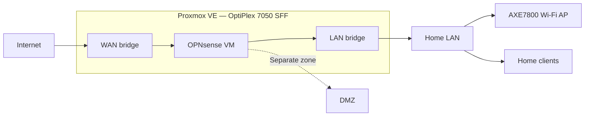

# Homelab

My current home infrastructure, built around a Dell OptiPlex 7050 SFF running Proxmox VE. The host runs 24/7, primarily to support an OPNsense VM that handles my home network and firewall.

Last updated: November 16, 2026.

## Network Overview

## Setup Overview

| Component | Role | Usage |
|-----------|------|-------|
| Proxmox VE | Hosts VMs and LXC containers on the OptiPlex 7050 SFF | 24/7 |
| OPNsense VM | Primary router/firewall, DHCP, DNS, reservations, and separate DMZ | 24/7 |
| TrueNAS SCALE VM | Mirrored storage, NFS, and authenticated SMB | 24/7 |
| PXC Server VM | Network Boot Services | Normally off; started when needed |
| Debian LXC | Local Development Web Server | Occasional |
| AXE7800 AP | Home Wi-Fi | Regular Use |

## Operating Notes

- OPNsense is the main everyday workload. Restarting its VM or the Proxmox host can interrupt home connectivity.
- TrueNAS SCALE provides NFS and authenticated SMB shares to LAN clients.
- Windows Server and other service experiments run in isolated lab environments.

## Archive

[Older projects and guides](archive/README.md) are preserved for reference. They document earlier setups, are no longer maintained, and may contain outdated instructions. This repository now focuses on documenting my current setup; future guides will be kept separately.
