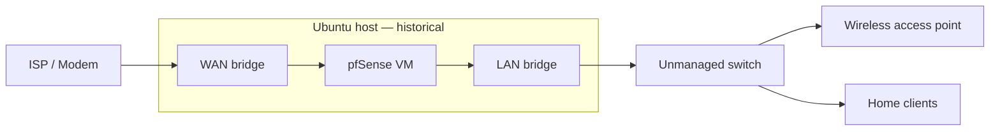

# pfSense on Ubuntu Home Server

> [!NOTE]
> **Archived guide.** Retained for reference; no longer maintained. See [current setup](../../README.md) or the [archive index](../README.md).

This records the earlier transition from a consumer all-in-one router to a pfSense VM on an Ubuntu server with QEMU/KVM and virt-manager. **OPNsense on Proxmox now serves as the home router.**

## What Was Implemented

- A pfSense VM handled home routing, firewalling, and DHCP.
- The previous wireless router was moved to access-point mode.
- Separate WAN and LAN bridges connected the VM to the network.
- Static addressing and DHCP reservations provided consistent addressing for selected devices.

## Historical Hardware

The documented host was a Dell OptiPlex 7050 SFF running Ubuntu, QEMU/KVM, and virt-manager. The earlier network inventory listed an Arris Touchstone CM8200A modem, Intel I350-AM2 dual-port NIC, TP-Link AXE95 access point, and TP-Link TL-SG105 unmanaged switch. 

## Earlier Logical Topology

## What remains useful

This project demonstrates separating routing from wireless access, attaching a router VM to distinct networks, and managing client addressing. It also illustrates the dependency introduced when home routing runs on the virtualization host.

The [pfSense setup walkthrough](setup/README.md) preserves the separate isolated installation lab. It is historical pfSense material, not an OPNsense installation or migration guide.
